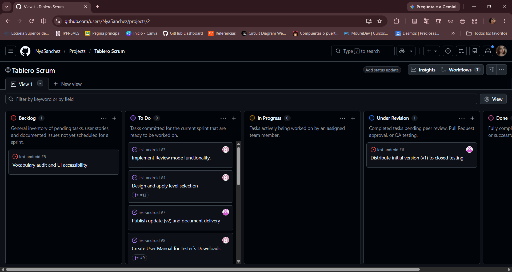
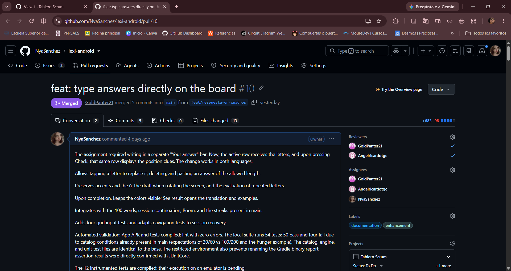
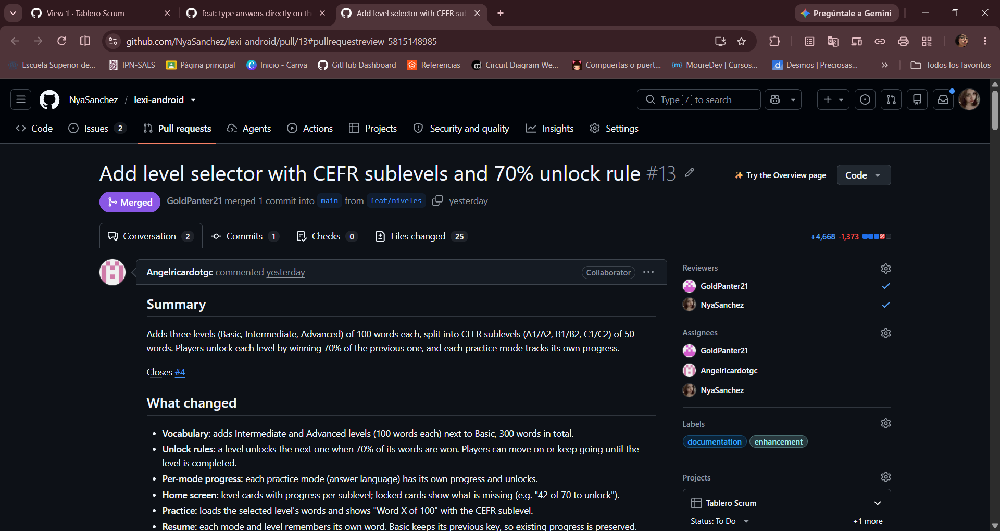
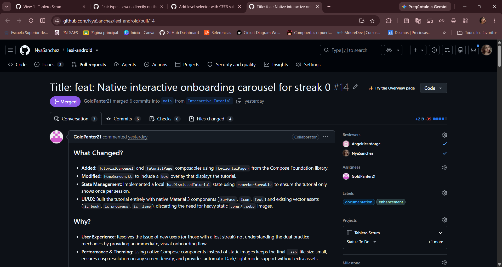
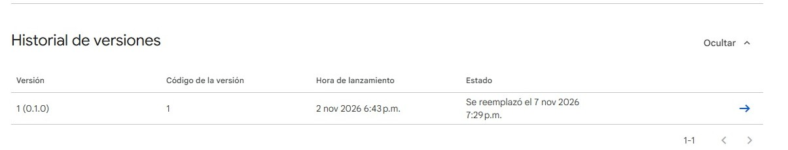
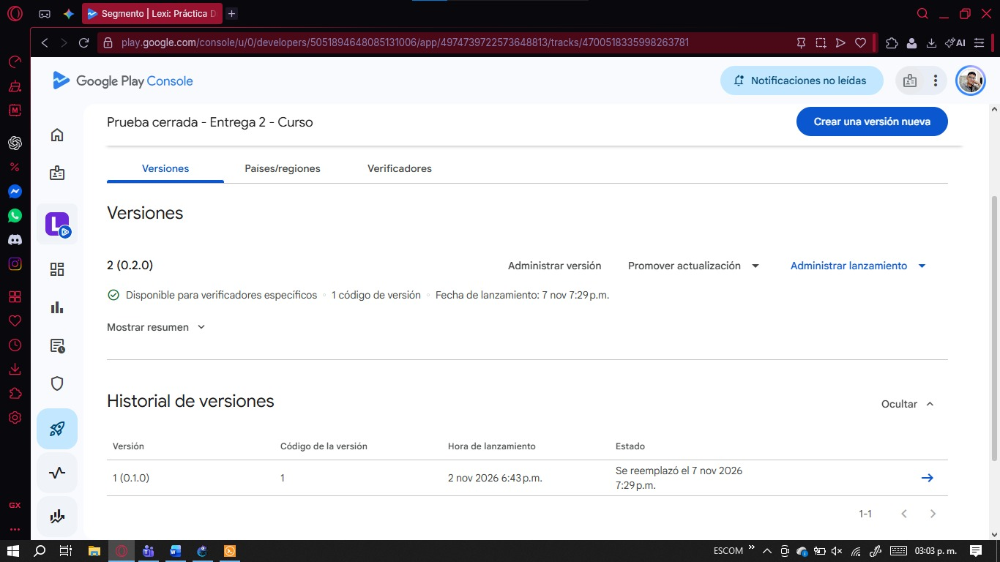
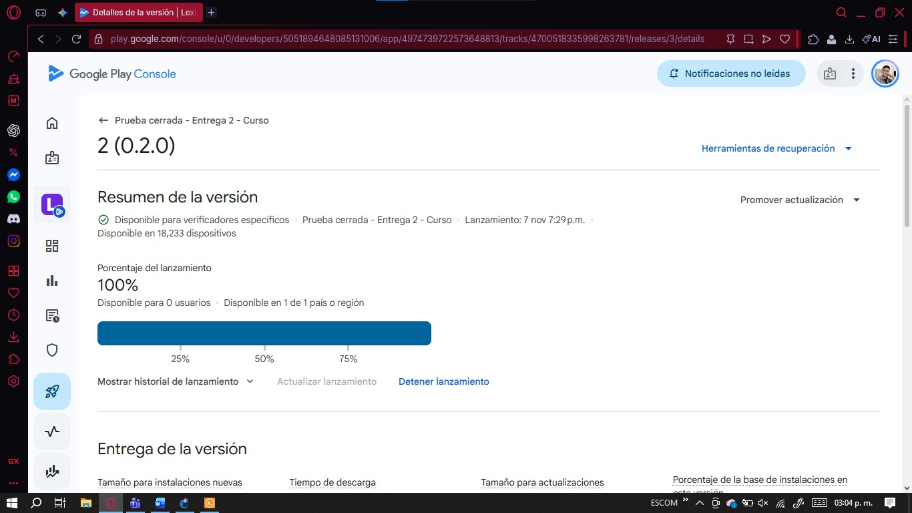
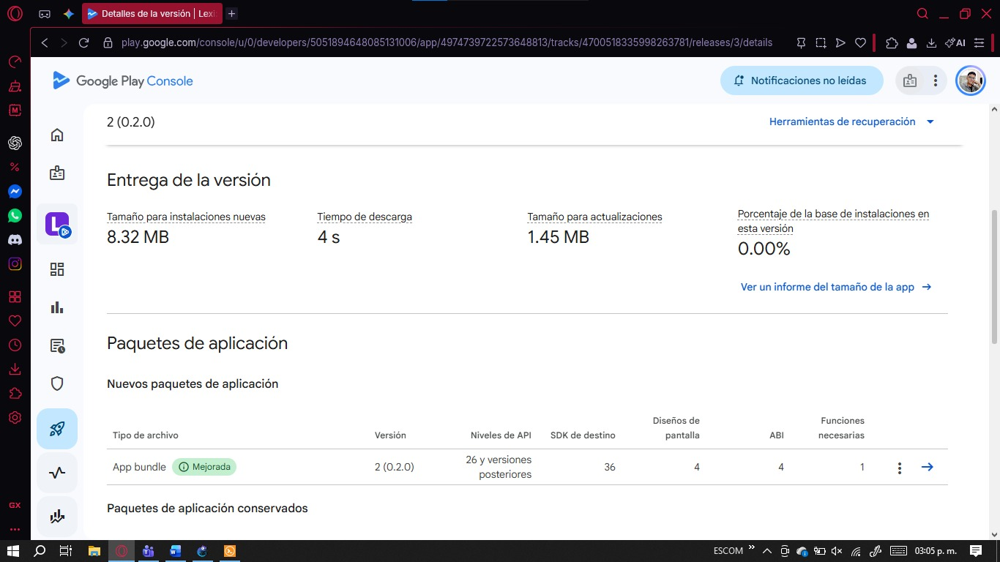

# Entrega 2 - Lexi

## Prueba cerrada y primera actualización en Google Play 
**Proyecto:** Lexi: Práctica Dual.  
**Fecha de entrega:** 8 de noviembre de 2026.      

### Integrantes
Sanchez Valadez Zyanya Maxi

Tellez Giron Angel Ricardo 

Orozco Aguilar Angel Isai

## Presentación

Lexi es una aplicación nativa de Android para practicar vocabulario en español e inglés mediante definiciones, respuestas escritas y pistas por letra. Este informe reúne la gestión del trabajo, las contribuciones individuales, la revisión de cambios, la primera publicación en prueba cerrada y la actualización del mismo paquete mediante Google Play.

La documentación relaciona los requisitos de la Entrega 2 con los PRs, issues, pruebas y evidencias del proyecto. Los campos **[COMPLETAR]** y **[INSERTAR EVIDENCIA]** identifican la información y los archivos que deben incorporarse antes de presentar el expediente.

## Índice de verificación

| Recurso | Referencia |
| --- | --- |
| Repositorio | [Repositorio de Lexi](https://github.com/NyaSanchez/lexi-android) |
| Código utilizado para la revisión documental | [Commit 9a73231](https://github.com/NyaSanchez/lexi-android/commit/9a73231c19a2fa2b6a4a3627a741a85ea3718ad1) |
| Tablero Scrum | [Tablero del proyecto](https://github.com/users/NyaSanchez/projects/2) |
| PRs integrados | [PR #10](https://github.com/NyaSanchez/lexi-android/pull/10), [PR #13](https://github.com/NyaSanchez/lexi-android/pull/13) y [PR #14](https://github.com/NyaSanchez/lexi-android/pull/14) |
| Issues de los cambios | [Issue #11](https://github.com/NyaSanchez/lexi-android/issues/11), [issue #4](https://github.com/NyaSanchez/lexi-android/issues/4) e [issue #12](https://github.com/NyaSanchez/lexi-android/issues/12) |
| Publicación y pruebas | [Publicación inicial, #6](https://github.com/NyaSanchez/lexi-android/issues/6), [actualización, #7](https://github.com/NyaSanchez/lexi-android/issues/7) y [auditoría, #5](https://github.com/NyaSanchez/lexi-android/issues/5) |
| Integración continua y revisión | [GitHub Actions](https://github.com/NyaSanchez/lexi-android/actions) y registros de QA de la sección 1.3 |
| Incorporación a la prueba | [Programa de testers de Lexi](https://play.google.com/apps/testing/io.github.nyasanchez.lexi) |
| Aplicación en Google Play | [Ficha de Lexi](https://play.google.com/store/apps/details?id=io.github.nyasanchez.lexi) |
| Manual para testers | [Manual de instalación](Manual.pdf) |
| Inventario de evidencias | [Archivos y fuentes](evidencia/entrega-2/README.md) |
| Matriz de QA | [COMPLETAR: incorporar `docs/pruebas.md` y enlazar aquí la matriz con los seis casos ejecutados] ||

## 1. Gestión Scrum y trabajo colaborativo

### 1.1. Tablero y sprint

El seguimiento del proyecto se concentra en el [tablero Scrum de Lexi](https://github.com/users/NyaSanchez/projects/2). La etapa comprende la preparación de la prueba cerrada, las mejoras de la aplicación, la revisión entre integrantes y la documentación de la actualización. La siguiente síntesis se fundamenta en los issues, commits y PRs del repositorio.

| Elemento del sprint | Registro |
| --- | --- |
| Nombre del sprint | Sprint: Prueba cerrada y actualización de Lexi. |
| Objetivo de la etapa | Consolidar la práctica bilingüe mediante niveles de vocabulario, un tutorial de inicio y la escritura directa en casillas; corregir el selector de texto, facilitar la incorporación de testers y documentar la publicación inicial y la actualización en Google Play. Este objetivo sintetiza el alcance de las tareas registradas. |
| Fechas de inicio y cierre | `Fecha de inicio:` 29 de Octubre de 2026 `Fecha de cierre:` 8 de noviembre de 2026 |
| Tareas comprometidas | El alcance registrado incluye vocabulario y continuación de práctica (#1), niveles (#4), auditoría (#5), publicación inicial (#6), actualización (#7), manual de testers (#8), corrección del selector (#11) y tutorial (#12). [COMPLETAR: confirmar cuáles se comprometieron al inicio del sprint y cuáles se incorporaron después]. |
| Responsables | **Zyanya Sanchez:** entrada en casillas, reporte del selector y revisión de cambios. **Angel Tellez:** vocabulario, continuidad de sesión, niveles, manual para testers y revisión. **Angel Orozco:** tutorial, corrección del selector, tareas de publicación y actualización, y revisión de QA. La tabla de actividades identifica la asignación o contribución que respalda cada responsabilidad. |
| Prioridad | Alta|
| Resultado | Se integraron el vocabulario ampliado y la continuación de práctica (#2), el manual para testers (#9), los niveles (#13), el tutorial (#14) y la entrada en casillas con la corrección del selector (#10). Al corte, el issue de actualización #7 está cerrado; publicación inicial #6 y auditoría #5 permanecen abiertos. La evidencia de los lanzamientos se presenta en las secciones 2 y 3. |

#### Actividades y responsabilidades registradas

El estado de la siguiente tabla corresponde al issue y al PR del repositorio.

| Actividad | Responsable o contribución identificada | Issue y PR | Estado registrado |
| --- | --- | --- | --- |
| Ampliar el vocabulario a 100 palabras y recuperar la sesión de práctica | Angel Tellez, autor del PR | [Issue #1](https://github.com/NyaSanchez/lexi-android/issues/1) y [PR #2](https://github.com/NyaSanchez/lexi-android/pull/2) | Issue cerrado y PR integrado el 01/11/2026 |
| Incorporar niveles, subniveles y desbloqueo por progreso | Angel Tellez, responsable del issue y autor del PR | [Issue #4](https://github.com/NyaSanchez/lexi-android/issues/4) y [PR #13](https://github.com/NyaSanchez/lexi-android/pull/13) | Issue cerrado y PR integrado el 07/11/2026 |
| Auditar vocabulario y accesibilidad | Zyanya Sanchez, responsable asignado | [Issue #5](https://github.com/NyaSanchez/lexi-android/issues/5) | Aierto |
| Gestionar el lanzamiento inicial en prueba cerrada | Angel Orozco, responsable asignado | [Issue #6](https://github.com/NyaSanchez/lexi-android/issues/6) | Abierto |
| Gestionar la actualización y documentar la entrega | Angel Orozco, responsable asignado | [Issue #7](https://github.com/NyaSanchez/lexi-android/issues/7) | Cerrado el 07/11/2026; evidencia del lanzamiento en la sección 3 |
| Preparar el manual de incorporación e instalación para testers | Angel Tellez, responsable del issue y autor del PR | [Issue #8](https://github.com/NyaSanchez/lexi-android/issues/8) y [PR #9](https://github.com/NyaSanchez/lexi-android/pull/9) | Issue cerrado y PR integrado el 03/11/2026 |
| Escribir directamente en las casillas y corregir el selector flotante | Zyanya Sanchez, autora de la entrada en casillas; Angel Orozco, autor de la corrección | [Issue #11](https://github.com/NyaSanchez/lexi-android/issues/11), [PR #10](https://github.com/NyaSanchez/lexi-android/pull/10) y [commit de corrección bbc5672](https://github.com/NyaSanchez/lexi-android/commit/bbc567212351c9e00df28745e88dea527223d7a1) | Issue cerrado y PR integrado el 07/11/2026 |
| Incorporar el tutorial para personas con racha de cero días | Angel Orozco, responsable del issue y autor del PR | [Issue #12](https://github.com/NyaSanchez/lexi-android/issues/12) y [PR #14](https://github.com/NyaSanchez/lexi-android/pull/14) | Issue cerrado y PR integrado el 07/11/2026 |

#### Cronología del trabajo documentado

Las fechas siguientes corresponden a la hora de Ciudad de México.

| Fecha | Actividad registrada | Referencia |
| --- | --- | --- |
| 01/11/2026 | Se integraron la ampliación del vocabulario y la recuperación de la sesión desarrolladas por Angel Tellez | [PR #2](https://github.com/NyaSanchez/lexi-android/pull/2) |
| 02/11/2026 | Se registraron tareas de niveles, auditoría, primera publicación y actualización | [#4](https://github.com/NyaSanchez/lexi-android/issues/4), [#5](https://github.com/NyaSanchez/lexi-android/issues/5), [#6](https://github.com/NyaSanchez/lexi-android/issues/6) y [#7](https://github.com/NyaSanchez/lexi-android/issues/7) |
| 03/11/2026 | Se integró el PR de Angel Tellez que normalizó el nombre del archivo del manual para testers | [PR #9](https://github.com/NyaSanchez/lexi-android/pull/9) |
| 04/11/2026 | Zyanya Sanchez abrió el PR de entrada en casillas y registró el defecto del selector | [PR #10](https://github.com/NyaSanchez/lexi-android/pull/10) e [issue #11](https://github.com/NyaSanchez/lexi-android/issues/11) |
| 05/11/2026 | Angel Orozco registró la tarea del tutorial interactivo | [Issue #12](https://github.com/NyaSanchez/lexi-android/issues/12) |
| 07/11/2026 | Se aprobaron e integraron los PRs de niveles, tutorial y entrada en casillas con la corrección del selector; también se cerró el issue de actualización | [PR #13](https://github.com/NyaSanchez/lexi-android/pull/13), [PR #14](https://github.com/NyaSanchez/lexi-android/pull/14), [PR #10](https://github.com/NyaSanchez/lexi-android/pull/10) e [issue #7](https://github.com/NyaSanchez/lexi-android/issues/7) |

#### Evidencia E-01. Tablero Scrum

### 1.2. Participación individual

| Integrante | Contribución verificable | Revisión de otro integrante |
| --- | --- | --- |
| Sanchez Valadez Zyanya Maxi | [cd10747, entrada directa en casillas](https://github.com/NyaSanchez/lexi-android/commit/cd10747d7b13a33fb69b4864de8200619609a354) y reporte del [defecto #11](https://github.com/NyaSanchez/lexi-android/issues/11) | [Aprobación del PR #13](https://github.com/NyaSanchez/lexi-android/pull/13#pullrequestreview-5815135642) |
| Tellez Giron Angel Ricardo | [cbb623e, niveles de vocabulario y desbloqueo](https://github.com/NyaSanchez/lexi-android/commit/cbb623e205a296402e9c64fee67773b3e38778bc) | [Aprobación del PR #10](https://github.com/NyaSanchez/lexi-android/pull/10#pullrequestreview-5815282323) |
| Orozco Aguilar Angel Isai | [7532bd4, tutorial](https://github.com/NyaSanchez/lexi-android/commit/7532bd4641aeae7f99ddb5c53287c19fa9d9dfb5) y [bbc5672, corrección del selector](https://github.com/NyaSanchez/lexi-android/commit/bbc567212351c9e00df28745e88dea527223d7a1) | [Aprobación y QA del PR #10](https://github.com/NyaSanchez/lexi-android/pull/10#pullrequestreview-5815640228) |

### 1.3. Tres PRs integrados

Los tres PRs siguientes están fusionados en `main`. Los nombres `pr-01`, `pr-02` y `pr-03` de las evidencias corresponden, respectivamente, a los PRs #10, #13 y #14.

| PR | Issue relacionado | Autor | Persona revisora | Estado del CI y verificación | Fecha de merge | Cambio entregado |
| --- | --- | --- | --- | --- | --- | --- |
| [#10](https://github.com/NyaSanchez/lexi-android/pull/10) | [#11](https://github.com/NyaSanchez/lexi-android/issues/11), corregido durante el PR | Zyanya Sanchez | [Angel Tellez](https://github.com/NyaSanchez/lexi-android/pull/10#pullrequestreview-5815282323) y [Angel Orozco](https://github.com/NyaSanchez/lexi-android/pull/10#pullrequestreview-5815640228) | Sin checks de CI registrados. QA manual en Oppo A58 con APK de depuración local | 07/11/2026 17:55:55 | Entrada en casillas, corrección del selector, ajustes del tutorial y aviso de novedades. Merge [ae2d839](https://github.com/NyaSanchez/lexi-android/commit/ae2d83910f1c04990774bd6d8684a977184b3dca) |
| [#13](https://github.com/NyaSanchez/lexi-android/pull/13) | [#4](https://github.com/NyaSanchez/lexi-android/issues/4) | Angel Tellez | [Zyanya Sanchez](https://github.com/NyaSanchez/lexi-android/pull/13#pullrequestreview-5815135642) y [Angel Orozco](https://github.com/NyaSanchez/lexi-android/pull/13#pullrequestreview-5815148985) | Sin checks de CI registrados. Pruebas unitarias aprobadas según el autor y QA manual en Oppo A58 | 07/11/2026 15:47:15 | 300 palabras, niveles A1-C2, desbloqueo al 70 % y continuación por modo y nivel. Merge [a6666aa](https://github.com/NyaSanchez/lexi-android/commit/a6666aa7545f85f9017860c9be1fc8e2dd41477d) |
| [#14](https://github.com/NyaSanchez/lexi-android/pull/14) | [#12](https://github.com/NyaSanchez/lexi-android/issues/12) | Angel Orozco | [Zyanya Sanchez](https://github.com/NyaSanchez/lexi-android/pull/14#pullrequestreview-5815134010) y [Angel Tellez](https://github.com/NyaSanchez/lexi-android/pull/14#pullrequestreview-5815294744) | Sin checks de CI registrados. Capturas y aprobaciones de QA del tutorial | 07/11/2026 16:24:15 | Carrusel nativo cuando la racha es 0 y opción de omitir |

#### Justificación de las verificaciones manuales

Al corte documental, la consulta de los commits finales de los tres PRs registró cero checks y cero estados de CI publicados. La validación de la interfaz se sustentó en pruebas sobre dispositivos físicos y en revisiones de otros integrantes, con capturas y resultados disponibles en los enlaces de la tabla. Estas pruebas permiten observar la edición de letras, los niveles y el tutorial durante su ejecución.

El primer avance del PR #10 registra 50 de 54 pruebas locales aprobadas y cuatro fallos del catálogo. Ese resultado corresponde a una etapa anterior a los cambios posteriores del equipo. El PR #13 declara pruebas unitarias aprobadas, sin un enlace de ejecución de CI. Los informes de los PRs #10 y #13 identifican un APK de depuración local en Oppo A58.

**[COMPLETAR: si se realizaron comprobaciones adicionales del código final, incluir fecha, responsable, commit, comandos ejecutados, resultados y enlace al informe o ejecución de CI].**

#### Evidencia E-02. PR #10: revisión, QA y merge

La [revisión de Angel Orozco](https://github.com/NyaSanchez/lexi-android/pull/10#pullrequestreview-5815640228) documenta la corrección del selector. Se conserva la [captura del comportamiento corregido](evidencia/entrega-2/pr-01-selector-corregido.png) y la [captura del defecto original](evidencia/entrega-2/pr-01-selector-defecto.png).

#### Evidencia E-03. PR #13: revisión, QA y merge

La [revisión de Angel Orozco](https://github.com/NyaSanchez/lexi-android/pull/13#pullrequestreview-5815148985) registra la comprobación del selector de niveles. La [captura de niveles](evidencia/entrega-2/pr-02-niveles-qa.png) muestra el progreso del nivel Básico y el bloqueo de los siguientes.

#### Evidencia E-04. PR #14: revisión, QA y merge

El [PR #14](https://github.com/NyaSanchez/lexi-android/pull/14) contiene capturas del tutorial y aprobaciones de revisión. Se conserva una [captura del carrusel](evidencia/entrega-2/pr-03-tutorial-qa.png).

## 2. Primera publicación en prueba cerrada

### 2.1. Identificación del lanzamiento inicial

| Dato | Registro de v1 |
| --- | --- |
| Nombre de la aplicación | Lexi: Práctica Dual |
| Identificador del paquete | `io.github.nyasanchez.lexi` |
| Canal cerrado | Prueba cerrada - Entrega 2 - Curso |
| Nombre del lanzamiento | Lexi. Practica Dual |
| versionName | app-release.aab |
| versionCode | 0.1.0 |
| Fecha de publicación | 2 de noviembre de 2026 6:43pm |
| Estado de publicación | Se remplazo el 7 de noviembre del 2026 7.29pm |
| Responsable de publicación | Orozco Aguilar Angel Isai |

#### Evidencia E-05. Lanzamiento inicial en Play Console

### 2.2. Incorporación e instalación por Google Play

El acceso de las personas probadoras se realiza mediante el [enlace de incorporación](https://play.google.com/apps/testing/io.github.nyasanchez.lexi), utilizando una cuenta autorizada. El [manual de instalación](Manual.pdf) incluye el acceso al programa y la ficha de Lexi instalada. Para la evaluación se presenta el registro del dispositivo y la versión inicial.

| Dato de la prueba inicial | Registro |
| --- | --- |
| Fecha y alias de tester | T03 de prueba, `Fecha:` 5 de noviembre |
| Dispositivo / Android / API | Xiaomi Poco, `modelo:` 20021211RG, `version de android:` 14UKQ1.231207.002,` API:` 34 |
| Versión instalada | 1(0.1.0) |

## 3. Actualización publicada en Google Play

### 3.1. Cambio funcional y criterio de aceptación

La entrada directa en el tablero y la corrección del selector están documentadas en el [PR #10](https://github.com/NyaSanchez/lexi-android/pull/10) y el [issue #11](https://github.com/NyaSanchez/lexi-android/issues/11). Los niveles del [PR #13](https://github.com/NyaSanchez/lexi-android/pull/13) y el tutorial del [PR #14](https://github.com/NyaSanchez/lexi-android/pull/14) constituyen mejoras adicionales integradas en el repositorio.

| Elemento del cambio presentado | Registro |
| --- | --- |
| Comportamiento anterior | En el defecto #11, los tiradores del selector cubrían la primera casilla al editar otra letra. [COMPLETAR: confirmar si este caso corresponde a la comparación v1/v2 presentada; de lo contrario, describir el comportamiento anterior del cambio elegido] |
| Comportamiento corregido | El QA de #10 registra que la casilla elegida permite sustituir su letra con el tablero legible, tras la corrección `bbc5672`. [COMPLETAR: resultado observado en la versión distribuida por Play] |
| Criterio de aceptación | Para la corrección del selector: editar una letra intermedia y una final en ambos idiomas; comprobar el indicador, la casilla modificada y el contador de intentos hasta pulsar Comprobar.|

### 3.2. Identificación de la segunda publicación

| Dato | Registro de v2 |
| --- | --- |
| Identificador del paquete | `io.github.nyasanchez.lexi` |
| Nombre del lanzamiento | Lexi. Practica Dual  |
| versionName | app-release.aab  |
| versionCode | 2(0.2.0) |
| Fecha de publicación | 7 de noviembre de 2026 7:29pm |
| Responsable de publicación |  Orozco Aguilar Angel Isai |

En el commit de referencia `9a73231`, la configuración declara `versionName = 0.2.0` y `versionCode = 1`. **[COMPLETAR: establecer la correspondencia entre el código fuente y los valores de los AAB publicados; describir cualquier ajuste de versión aplicado al compilar y enlazar su registro].**

#### Evidencia E-06. Historial de los dos lanzamientos

#### Evidencia E-07. Estado publicado de la actualización

#### Evidencia E-08. Notas de versión publicadas

### 3.3. Actualización en el dispositivo y conservación de datos

| Dato | Registro |
| --- | --- |
| Fecha y alias de tester | T03 de prueba, `Fecha:` 7 de noviembre |
| Dispositivo / Android / API | Xiaomi Poco, `modelo:` 20021211RG, `version de android:` 14UKQ1.231207.002,` API:` 34 |
| Versión instalada | 2(0.2.0) |

## 4. Pruebas, documentación y verificación final

### 4.1. Matriz de QA

**[COMPLETAR: incorporar y enlazar `docs/pruebas.md` con al menos seis casos reales. Cada registro debe incluir fecha, dispositivo/API, versión, pasos, resultado esperado, resultado observado y evidencia accesible].**

| Caso obligatorio | Registro y evidencia |
| --- | --- |
| QA-01. Instalación inicial por Google Play | [COMPLETAR: enlace al caso y a E-07] |
| QA-02. Tarea principal: partida completa | [COMPLETAR: enlace al caso, resultado y ejemplos de la partida] |
| QA-03. Error o entrada inválida | [COMPLETAR: enlace al caso y captura con mensaje de error y contador de intentos] |
| QA-04. Actualización conservando la instalación | [COMPLETAR: enlace al caso y a E-11] |
| QA-05. Mejora o corrección de v2 | [COMPLETAR: enlace al caso y al comportamiento actualizado en el dispositivo] |
| QA-06. Conservación de datos o estado | [COMPLETAR: enlace al caso y comparación antes/después] |

#### Evidencia E-12. Resultados de QA

> **[INSERTAR EVIDENCIA E-12]** Capturas o videos de la partida, la entrada inválida y la mejora comprobada, enlazados con los casos de `docs/pruebas.md`. Pueden reutilizarse E-07 y E-11 si muestran los pasos y resultados del caso. Nombres sugeridos: `qa-partida.png`, `qa-entrada-invalida.png` y `qa-mejora-v2.png`.

<!--

-->

